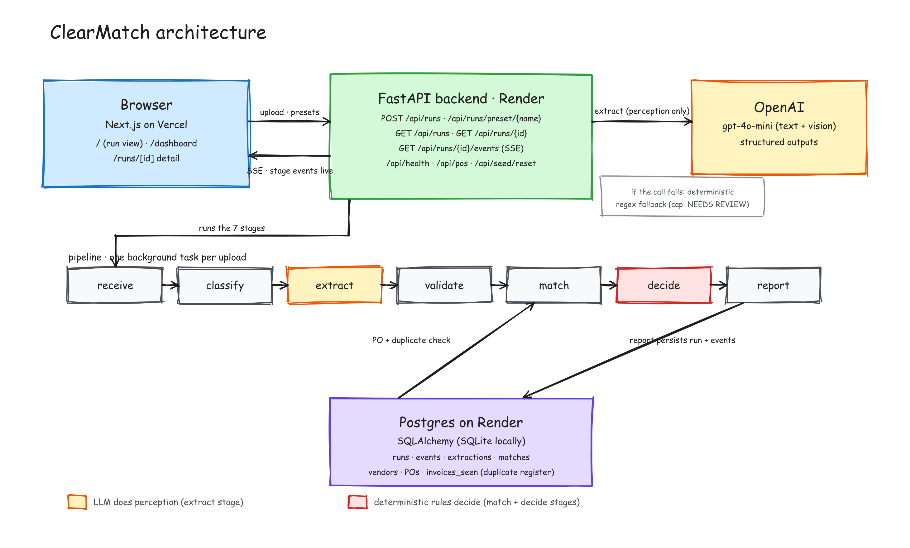

# ClearMatch

Invoice-to-PO matching with explainable decisions. Built for the Zamp AI
Solutions Associate case study, PS-1 (Finance/AP). Design history in
[PLAN.md](PLAN.md), deployment in [DEPLOY.md](DEPLOY.md), demo runbook in
[DEMO_SCRIPT.md](DEMO_SCRIPT.md).

A vendor invoice PDF goes in, and a reasoned decision comes out: `AUTO-APPROVE`,
`NEEDS REVIEW`, or `REJECT`, with reason codes, a confidence score, a
plain-English explanation, and a recommended next action. The seven pipeline
stages (receive, classify, extract, validate, match, decide, report) stream live
into the UI as they execute, and every run lands in the dashboard.

## Architecture



A FastAPI backend runs the pipeline and a deterministic decision engine; the
LLM does perception only, it never decides. Next.js frontend, SQLite locally,
Postgres on Render in production. The editable diagram source is
[docs/architecture.excalidraw](docs/architecture.excalidraw) (opens at
excalidraw.com).

## Run it locally

Backend on http://localhost:8000:

```bash
cd backend
python3 -m venv ../.venv && ../.venv/bin/pip install -r requirements.txt
../.venv/bin/python -m uvicorn app.main:app --reload
```

Frontend on http://localhost:3000, in a second terminal:

```bash
cd frontend
npm install
npm run dev
```

The frontend resolves its API base at runtime from its `/api-base` route and
defaults to `http://localhost:8000`, so no env setup is needed for the standard
local setup. If your backend runs elsewhere, start the dev server with
`API_BASE_URL=http://host:port npm run dev`.

Both halves work with no API key: extraction falls back to a deterministic
regex extractor and decisions cap at `NEEDS REVIEW`. To enable the real LLM
path, copy `backend/.env.example` to `backend/.env`, paste your
`OPENAI_API_KEY`, and source the file into the environment before starting
uvicorn (`set -a; source .env; set +a`). Sanity-check the key with
`backend/tools/check_llm.py` (run instructions in its docstring).

## Demo presets

One-click buttons on the Run page, each wired to a committed test PDF in
`testdata/`.

| Preset | Scenario | Expected |
|--------|----------|----------|
| happy | clean digital invoice, exact PO match | AUTO-APPROVE |
| scanned | image-only PDF, vision-OCR path | NEEDS REVIEW (`EXTRACTION_DEGRADED_OCR`) |
| duplicate | same vendor+invoice number resubmitted | REJECT (`DUPLICATE_INVOICE_NUMBER`) |
| split_a then split_b | one PO, two invoices | AUTO-APPROVE against the remaining balance (run A before B) |
| breach | total 4% over PO | NEEDS REVIEW (`PO_AMOUNT_EXCEEDED`) |
| missing | no invoice number / PO ref | NEEDS REVIEW, heuristic match |
| linemismatch | totals agree, unit prices don't | NEEDS REVIEW (`PO_LINE_PRICE_MISMATCH`) |

Reset demo state any time: `POST /api/seed/reset` (send the `X-Reset-Token`
header when `RESET_TOKEN` is set in the backend env).

## Tests

```bash
cd backend && ../.venv/bin/python -m pytest tests/ -q   # 39 tests
```
